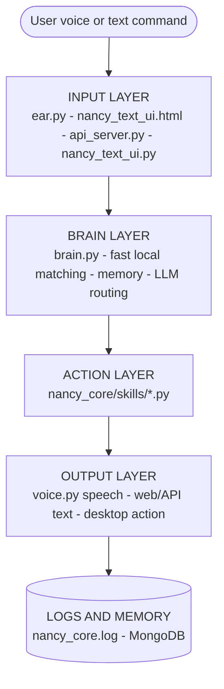

<div align="center">

# Nancy Voice Assistant v2.5
### Full Code Working Data

*A Windows voice + text assistant with a fast-command brain, an NVIDIA-hosted LLM, 14 automation skill modules, a FastAPI backend and a browser command center.*

    

[](https://drive.google.com/drive/folders/1VcLEkdEENb1ieLipG6LMYzM3xbAc0ATD?usp=sharing)

</div>

---

## Download

Get the full Nancy Voice Assistant v2.5 project from Google Drive:

**[Download the project from Google Drive](https://drive.google.com/drive/folders/1VcLEkdEENb1ieLipG6LMYzM3xbAc0ATD?usp=sharing)**

After downloading, extract the folder, then follow the [Quick Start](#1-project-overview) to install dependencies and run it.

---

## Table of Contents

1. [Project Overview](#1-project-overview)
2. [High-Level Architecture](#2-high-level-architecture)
3. [Main Source File Map](#3-main-source-file-map)
4. [Core Package Map](#4-core-package-map)
5. [Skills Folder Map](#5-skills-folder-map)
6. [Important Runtime Data](#6-important-runtime-data)
7. [Main App (main.py)](#7-main-app-mainpy)
8. [API Server (api_server.py)](#8-api-server-api_serverpy)
9. [Brain (nancy_core/brain.py)](#9-brain-nancy_corebrainpy)
10. [LLM Wrapper (nancy_core/llm_wrapper.py)](#10-llm-wrapper-nancy_corellm_wrapperpy)
11. [Ear (nancy_core/ear.py)](#11-ear-nancy_coreearpy)
12. [Voice (nancy_core/voice.py)](#12-voice-nancy_corevoicepy)
13. [Config (nancy_core/config.py)](#13-config-nancy_coreconfigpy)
14. [Utils (nancy_core/utils.py)](#14-utils-nancy_coreutilspy)
15. [Clipboard Watcher (nancy_core/clipboard_watcher.py)](#15-clipboard-watcher-nancy_coreclipboard_watcherpy)
16. [Skills: apps.py](#16-skills-appspy)
17. [Skills: desktop.py](#17-skills-desktoppy)
18. [Skills: system_ops.py](#18-skills-system_opspy)
19. [Skills: web.py](#19-skills-webpy)
20. [Skills: utilities.py](#20-skills-utilitiespy)
21. [Skills: file_ops.py](#21-skills-file_opspy)
22. [Skills: editor_ops.py](#22-skills-editor_opspy)
23. [Skills: messaging_ops.py](#23-skills-messaging_opspy)
24. [Skills: settings.py](#24-skills-settingspy)
25. [Skills: startup_ops.py](#25-skills-startup_opspy)
26. [Skills: self_locator.py](#26-skills-self_locatorpy)
27. [Skills: mic_selector.py](#27-skills-mic_selectorpy)
28. [Skills: gpu_ops.py](#28-skills-gpu_opspy)
29. [Skills: vision.py](#29-skills-visionpy)
30. [Web UI (nancy_text_ui.html)](#30-web-ui-nancy_text_uihtml)
31. [Tkinter Text UI (nancy_text_ui.py)](#31-tkinter-text-ui-nancy_text_uipy)
32. [Logo Widget (nancy_logo_widget.py)](#32-logo-widget-nancy_logo_widgetpy)
33. [Autostart (nancy_autostart.py)](#33-autostart-nancy_autostartpy)
34. [Batch and VBS Launchers](#34-batch-and-vbs-launchers)
35. [Test and Debug Files](#35-test-and-debug-files)
36. [Scratch Files](#36-scratch-files)
37. [Data Flow by Command Type](#37-data-flow-by-command-type)
38. [MongoDB Data](#38-mongodb-data)
39. [Security and Maintenance Notes](#39-security-and-maintenance-notes)
40. [Files Safe to Ignore During Code Review](#40-files-safe-to-ignore-during-code-review)
41. [Reading Order: Most Important Files First](#41-reading-order-most-important-files-first)

---

## 1. Project Overview

Nancy Voice Assistant v2.5 is a background Windows desktop assistant that accepts voice or text commands, decides what to do (fast local rules, an NVIDIA-hosted LLM, or a local fallback), runs automation "skills" such as app control, web search, file work, WhatsApp and system control, and replies by voice, web UI or API. This guide explains how the project works, what every important file does, and which function lives in which file.

It focuses on source code and runtime files. Generated files such as `build/`, `dist/`, `__pycache__/`, logs and temporary audio files are listed separately because they are not the main source code.

### Quick Start

| Task | Command |
|---|---|
| Main application | `python main.py` |
| API server only | `python api_server.py` |
| Fast / offline mode | `python nancy_fast.py` |
| Install dependencies | `pip install -r requirements.txt` |

---

## 2. High-Level Architecture

Every command, whether spoken or typed, flows through four layers and ends in logs and memory.



| Layer | Components |
|---|---|
| **INPUT LAYER** | Voice: ear.py  /  Web UI: nancy_text_ui.html  /  REST API: api_server.py  /  Tk UI: nancy_text_ui.py |
| **BRAIN LAYER** | nancy_core/brain.py  /  fast local matching  /  memory load/save  /  LLM routing |
| **ACTION LAYER** | nancy_core/skills/*.py  /  apps, web search, files, WhatsApp, system control |
| **OUTPUT LAYER** | voice.py speech  /  web / API text response  /  desktop action result |
| **LOGS AND MEMORY** | nancy_core.log  /  MongoDB collections |

---

## 3. Main Source File Map

| File | Main work |
|---|---|
| `main.py` | Main desktop assistant runner. Starts tray icon, voice engine, microphone, brain, clipboard watcher, API server, hotkey and the listen loop. |
| `api_server.py` | FastAPI backend used by the browser UI and external clients. Exposes health, chat history, command and device endpoints. |
| `nancy_text_ui.html` | Main browser command center UI. Sends commands to `http://127.0.0.1:8000/api/text-command`. |
| `nancy_text_ui.py` | Simple Tkinter desktop text chat UI. Uses Brain and VoiceEngine directly. |
| `nancy_fast.py` | Older/alternate fast mode runner. Forces offline voice and a simpler main loop. |
| `nancy_logo_widget.py` | Floating draggable Tkinter logo widget with right-click menu. |
| `nancy_autostart.py` | Windows startup/watchdog manager. Creates the VBS launcher and keeps `main.py` running. |
| `config.py` | Older top-level config constants and aliases. The active core config is mostly `nancy_core/config.py`. |
| `requirements.txt` | Python dependencies. |
| `NancyVoiceAssistant.spec` | PyInstaller build config for creating `dist/NancyVoiceAssistant.exe`. |
| `README.md` | Short setup and usage notes. |
| `CLIENT_CODE_WORKTREE.md` | Client-friendly folder explanation. |
| `CLIENT_FLOWCHART.md` | Client-friendly architecture flowchart. |
| `ENHANCEMENTS.md` | Notes about v2.5 enhancements. |

---

## 4. Core Package Map

| File | Main work |
|---|---|
| `nancy_core/brain.py` | Central decision engine. Registers skills, manages MongoDB memory, chooses fast-track / local / LLM path. |
| `nancy_core/llm_wrapper.py` | Connects to the NVIDIA chat completions API and parses `CALL: tool_name(...)` responses. |
| `nancy_core/ear.py` | Microphone selection, calibration, listening, speech recognition through RTX Whisper or Google. |
| `nancy_core/voice.py` | Text-to-speech queue using Edge TTS online and pyttsx3 offline fallback. |
| `nancy_core/config.py` | Active runtime config loaded from `.env`: NVIDIA keys, speech settings, MongoDB URI, wake words. |
| `nancy_core/utils.py` | Shared logger and directory helper. |
| `nancy_core/clipboard_watcher.py` | Background clipboard automation. Detects copied text, opens Notepad / search / apps / calculator. |
| `nancy_core/__init__.py` | Empty package marker. |

---

## 5. Skills Folder Map

| File | Main work |
|---|---|
| `skills/apps.py` | Open / close / list / refresh desktop applications. |
| `skills/desktop.py` | Brightness, window control, typing, hotkey pressing. |
| `skills/system_ops.py` | Volume, lock, shutdown, restart, sleep, Task Manager, processes, system info, WiFi. |
| `skills/web.py` | Open websites, Google-style search cards, website replication, YouTube, Google Maps. |
| `skills/utilities.py` | Time, date, battery, Wikipedia cards, clipboard, device info, translation. |
| `skills/file_ops.py` | Create / read / write / list / delete files, save clipboard, open Notepad. |
| `skills/editor_ops.py` | Write/edit content in files or active applications. |
| `skills/messaging_ops.py` | WhatsApp, Telegram and email message flows. |
| `skills/settings.py` | Open Windows Settings pages through `ms-settings:` URIs. |
| `skills/startup_ops.py` | Enable / disable / check Windows autostart. |
| `skills/self_locator.py` | Finds the Nancy folder after moves and repairs the autostart registry path. |
| `skills/mic_selector.py` | Lists / ranks microphones and selects the best one. |
| `skills/gpu_ops.py` | Detects CUDA / NVIDIA GPU details. |
| `skills/vision.py` | Screenshot capture and screen-analysis marker. |
| `skills/__init__.py` | Empty package marker. |

> **Note:** All skill paths above are relative to `nancy_core/`.

---

## 6. Important Runtime Data

| File or folder | Meaning |
|---|---|
| `.env` | Private runtime secrets and settings: NVIDIA API keys, MongoDB URI, RTX mode, microphone index, language. |
| `nancy_core.log` | Main log file from `nancy_core/utils.py`. |
| `nancy_autostart.log` | Startup/watchdog log from `nancy_autostart.py` and batch scripts. |
| `nancy_memory.json` | Older/local memory-style file. Current main memory path is MongoDB. |
| `PyWhatKit_DB.txt` | PyWhatKit generated support file. |
| `speech_*.mp3`, `temp_speech.mp3`, `test_speech_*.mp3` | Generated/test speech audio files. |
| `Nancy virtual assistant.png` | UI / tray / logo image. |
| `website_replicas/` | Output folder created by `web.replicate_website()`. |
| `Screenshots/` | Screenshot/output folder if present. |
| `build/` | PyInstaller build artifacts. Generated, not source. |
| `dist/` | Packaged executable and data output. Generated / delivery files. |
| `__pycache__/` | Python bytecode cache. Generated. |

---

## 7. Main App (main.py)

**Purpose:** Start Nancy as a background Windows desktop assistant.

### Working sequence

1. `check_singleton()` binds local port 12345 so only one Nancy instance runs.
2. `verify_and_heal()` checks the project folder and fixes the startup registry path if moved.
3. `ensure_autostart_registered()` and `ensure_startup_shortcut()` register Windows autostart.
4. Creates `VoiceEngine`, `Ear` and `Brain`.
5. Starts the clipboard watcher.
6. Registers the global hotkey Ctrl+Alt+N.
7. Starts `api_server.py` in the background if port 8000 is free.
8. Creates the system tray icon with menu items.
9. Enters the voice loop: listen through `Ear.listen()`, check wake word or active follow-up window, strip the wake word, send the command to `process_command_async()`, speak the reply through `VoiceEngine.speak()`.

### Functions

| Function | Work |
|---|---|
| `get_greeting()` | Builds morning / afternoon / evening startup greeting. |
| `on_hotkey_pressed()` | Sets `HOTKEY_TRIGGERED` so the next loop listens immediately. |
| `_port_open(host, port)` | Checks if the API port is already bound. |
| `start_api_server()` | Starts `api_server.py` in a hidden background process and waits for port 8000. |
| `stop_api_server()` | Kills the background API server process. |
| `_build_tray_icon()` | Loads the Nancy logo or creates a fallback "N" icon. |
| `quit_app(icon, _item)` | Stops API, sets stop event, stops tray icon, exits. |
| `open_dashboard(icon, _item)` | Starts API and opens `nancy_text_ui.html`. |
| `open_web_ai(_icon, _item)` | Opens the ChatGPT website. |
| `process_command_async(brain, voice, text)` | Runs `brain.think()` in a thread pool and speaks the reply. |
| `check_singleton()` | Uses a socket lock to prevent duplicate instances. |
| `main()` | Full boot, tray setup, hotkey setup and the voice listen loop. |

---

## 8. API Server (api_server.py)

**Purpose:** Expose Nancy through a REST API for the web UI or other clients.

Global objects: `brain = Brain()` and `voice = VoiceEngine()`.

### API endpoints

| Endpoint | Method | Work |
|---|---|---|
| `/api/health` | GET | Returns component status and database status. |
| `/api/chat-history` | GET | Returns in-memory chat history from Brain. |
| `/api/clear-chat` | POST | Clears memory in Brain and MongoDB. |
| `/api/text-command` | POST | Main command endpoint. Calls `brain.think()`, optionally speaks the reply. |
| `/api/device-info` | GET | Returns current device info from Brain. |
| `/api/all-devices` | GET | Returns all device records from MongoDB. |

### Models

| Class | Work |
|---|---|
| `CommandRequest` | Validates command text, speak flag, mode, language. |
| `CommandResponse` | Standard success response with reply text. |
| `ErrorResponse` | Standard error shape. |
| `ChatEntry` | One chat history row. |
| `DeviceInfo` | Device metadata model. |

### Functions

| Function | Work |
|---|---|
| `health_check()` | Builds health JSON. |
| `get_chat_history()` | Returns safe chat history entries. |
| `clear_chat()` | Clears memory through `brain.clear_memory()`. |
| `text_command(req)` | Validates text, calls `brain.think(text, mode, language)`, speaks if requested. |
| `get_device_info()` | Returns `brain.get_device_info()`. |
| `get_all_devices()` | Reads `brain.device_collection` and converts `_id` to string. |
| `value_error_handler(request, exc)` | Converts validation errors to JSON. |

---

## 9. Brain (nancy_core/brain.py)

**Purpose:** central intelligence and command router.

### Main responsibilities

- Connect to MongoDB.
- Load and save memory.
- Register all skill functions.
- Try fast local regex patterns first.
- If the online LLM is available, call `LLMWrapper`.
- If the LLM fails or refuses, run the local command handler.
- Save device info to MongoDB.

### Important data

| Field | Meaning |
|---|---|
| `db_available` | Whether MongoDB is reachable. |
| `memory_collection` | MongoDB collection for chat memory. |
| `device_collection` | MongoDB collection for device info. |
| `history` | In-memory chat history, capped at 100 items. |
| `tools_list` | All callable automation functions exposed to the LLM. |
| `llm` | `LLMWrapper` instance. |

### Methods

| Method | Work |
|---|---|
| `__init__()` | Initializes DB, starts background memory load, registers tools, creates the LLM wrapper. |
| `chat(user_input, mode, language)` | Backward-compatible wrapper around `think()`. |
| `_init_database()` | Connects to MongoDB and sets collections. |
| `_register_tools()` | Registers apps, system, web, utilities, desktop, file, startup, editor and messaging tools. |
| `_background_load_memory()` | Loads memory in a background thread. |
| `load_memory(limit)` | Reads latest memory from MongoDB in chronological order. |
| `save_memory(user_text, model_text)` | Adds memory to RAM and MongoDB. |
| `clear_memory()` | Clears RAM history and deletes MongoDB memory entries. |
| `think(user_input, mode, language)` | Main command processor. Uses fast-track, LLM, fallback local commands, then saves memory. |
| `_fast_track(user_input)` | Regex fast path for time, date, app launch, lock, WhatsApp, editor, maps, translation. |
| `_handle_local_command(user_input)` | Local fallback for app / system / web / file / clipboard / volume / window / startup / messaging / settings commands. |
| `get_device_info()` | Builds hostname, OS, CPU, Python and IP info. |
| `save_device_info()` | Upserts device info into MongoDB. |

### Tool categories registered in _register_tools()

| Category | Tools |
|---|---|
| `apps` | open / close / list / refresh apps |
| `system_ops` | volume, power, task manager, process, system info, WiFi |
| `web` | website, search, YouTube, website replication, maps |
| `utilities` | time, date, battery, Wikipedia, clipboard, device info, translation |
| `vision` | screenshot |
| `settings` | Windows Settings pages |
| `desktop` | brightness, windows, keyboard |
| `file_ops` | save / read / create / list / paste / delete / open files |
| `startup_ops` | autostart |
| `editor_ops` | write / edit files and applications |
| `messaging_ops` | WhatsApp / Telegram / email |

---

## 10. LLM Wrapper (nancy_core/llm_wrapper.py)

**Purpose:** talk to NVIDIA's OpenAI-compatible chat completion API and execute tool calls.

### Important behavior

- Uses `config.NVIDIA_API_KEY`.
- Sends a system prompt with the available tools.
- Parses the function name and arguments with regex.
- Executes the matching Python function from `tools_list`.
- Filters refusal-style replies and sends them back to Brain as `__LOCAL__:<command>`.

The model is expected to answer with tool call text like this:

```text
CALL: open_application(app_name=notepad)
```

| Function | Work |
|---|---|
| `_is_refusal(text)` | Detects refusal or limitation phrases. |
| `_build_system_prompt(persona, tools_info, language_name, language)` | Builds LLM instruction text with the tool list and language rule. |
| `LLMWrapper.__init__(tools_list)` | Stores API headers, model URL and tools. |
| `route_query(user_input, history, mode, language)` | Calls `query_nvidia()` if an NVIDIA key exists. |
| `_get_persona(mode)` | Maps mode 1..5 to a response style. |
| `_execute_tool(func_name, args)` | Finds a registered function and calls it. |
| `query_nvidia(user_input, history, mode, language)` | Sends the request to NVIDIA, parses the reply, handles tool calls, returns final text. |
| `_encode_image(image_path)` | Base64-encodes an image file. Not actively integrated into the main vision flow. |

---

## 11. Ear (nancy_core/ear.py)

**Purpose:** voice input and speech recognition.

### Working sequence

1. Create `speech_recognition.Recognizer`.
2. Choose a microphone: the configured `MIC_DEVICE_INDEX`, else the best microphone from `mic_selector`, else the system default.
3. Calibrate ambient noise.
4. If RTX mode and Faster-Whisper are available, load the GPU Whisper model.
5. On every `listen()`: capture audio, transcribe through RTX Whisper if possible, fall back to Google speech recognition, return lowercase text or `None`.

| Method | Work |
|---|---|
| `__init__()` | Initializes recognizer, mic, RTX settings. |
| `_init_mic()` | Selects / opens the microphone. |
| `_try_open_mic(device_index)` | Tests and opens one microphone. |
| `_switch_to_next_best_mic()` | Re-scans the mic list after repeated failures. |
| `_init_rtx_power()` | Loads the Faster-Whisper GPU model if enabled. |
| `calibrate()` | Re-calibrates ambient noise. |
| `_maybe_recalibrate()` | Starts background calibration every 5 minutes. |
| `listen(timeout, phrase_time_limit)` | Captures and transcribes speech. |
| `_transcribe_rtx(audio)` | Saves a temp WAV and transcribes with Faster-Whisper. |
| `_transcribe_google(audio)` | Uses Google Speech Recognition. |
| `get_status()` | Returns microphone / RTX diagnostic state. |

---

## 12. Voice (nancy_core/voice.py)

**Purpose:** text-to-speech output.

### Working sequence

1. Starts a speech queue.
2. Starts a worker thread.
3. Starts an asyncio event loop for Edge TTS.
4. Initializes `pygame.mixer`.
5. Initializes offline `pyttsx3` inside the worker thread.
6. `speak()` adds text to the queue.
7. The worker plays one message at a time.
8. Online mode uses Edge TTS MP3 chunks.
9. Offline fallback uses `pyttsx3`.

| Method | Work |
|---|---|
| `__init__()` | Creates queue, threads, event loop, pygame mixer. |
| `_run_async_loop()` | Runs the asyncio loop forever. |
| `_voice_worker()` | Serially consumes the speech queue and plays each item. |
| `setup_offline_voice()` | Picks a female / Zira voice and sets speech rate. |
| `speak(text, mode)` | Shortens and queues text. |
| `_shorten_for_speech(text)` | Limits output to about two sentences / 300 characters. |
| `process_online_speech(text, mode)` | Generates Edge TTS MP3 chunks and plays via pygame. |
| `process_offline_speech(text)` | Speaks through `pyttsx3`. |
| `stop()` | Clears the queue and stops playback. |

---

## 13. Config (nancy_core/config.py)

**Purpose:** active configuration loaded from `.env`.

| Setting | Work |
|---|---|
| `NVIDIA_API_KEY` | Main LLM API key. |
| `NVIDIA_IMAGE_API_KEY` | Image API key placeholder / support. |
| `NVIDIA_TRANSLATION_API_KEY` | Translation key placeholder / support. |
| `NVIDIA_INVOKE_URL` | NVIDIA chat completions endpoint. |
| `NVIDIA_MODEL` | Current model: `mistralai/mistral-small-4-119b-2603`. |
| `RTX_MODE` | Enables local GPU transcription if possible. |
| `GPU_MODEL_SIZE` | Faster-Whisper model size. |
| `EDGE_TTS_VOICE` | Default online voice. |
| `SPEECH_LANGUAGE` | Speech recognition language. |
| `WAKE_WORDS` | Wake words like nancy, hey nancy, assistant. |
| `ACTIVE_LISTENING_WINDOW` | Follow-up command window in seconds. |
| `MIC_DEVICE_INDEX` | Configured microphone index; -1 means default / auto. |
| `CLIPBOARD_AUTOMATION_ENABLED` | Enables the clipboard watcher. |
| `MONGODB_URI` | MongoDB connection string. |
| `DB_NAME` | Database name: `nancy_ai`. |
| `COLLECTION_NAME` | Memory collection: `user_memory`. |
| `SCREENSHOT_DIR` | Screenshot save directory. |
| `LOG_FILE` | Log file name: `nancy_core.log`. |
| `validate_config()` | Function. Logs warnings for missing critical values. |

---

## 14. Utils (nancy_core/utils.py)

**Purpose:** shared logging and directory helper.

| Function | Work |
|---|---|
| `log(message, level)` | Writes to the queue-based file and console logger. |
| `ensure_dir(path)` | Creates the directory if missing. |

---

## 15. Clipboard Watcher (nancy_core/clipboard_watcher.py)

**Purpose:** background clipboard automation.

| Function | Work |
|---|---|
| `_contains_number(text)` | Returns true if clipboard text contains a digit. |
| `clipboard_loop(stop_event)` | Watches clipboard changes. Opens app guesses, Notepad, web search, and Calculator when copied text has numbers. |
| `start_clipboard_watcher(stop_event)` | Starts a daemon thread if enabled in config. |

---

## 16. Skills: apps.py

**Purpose:** launch and close applications.

| Function | Work |
|---|---|
| `_load_appopener()` | Lazy imports AppOpener open/close functions. |
| `open_application(app_name)` | Opens apps by aliases, fast system paths, AppOpener or fallback commands. Also routes settings / system tools. |
| `close_application(app_name)` | Closes via AppOpener or `taskkill`. |
| `list_installed_applications()` | Uses the AppOpener cache and returns a visible app list. |
| `refresh_application_cache()` | Refreshes the AppOpener app cache. |

---

## 17. Skills: desktop.py

**Purpose:** desktop UI automation.

| Function | Work |
|---|---|
| `_get_sbc()` | Lazy loads `screen_brightness_control`. |
| `_get_gw()` | Lazy loads `pygetwindow`. |
| `_get_brightness_powershell()` | Reads current brightness through WMI PowerShell. |
| `_set_brightness_powershell(level)` | Sets brightness through WMI PowerShell. |
| `set_brightness(level)` | Sets brightness using the library or PowerShell fallback. |
| `brightness_up(amount)` | Increases brightness. |
| `brightness_down(amount)` | Decreases brightness. |
| `minimize_current_window()` | Minimizes the active window. |
| `maximize_current_window()` | Maximizes the active window. |
| `close_current_window()` | Closes the active window. |
| `switch_window(window_title)` | Activates the first matching window title. |
| `type_text(text)` | Types text into the active UI using pyautogui. |
| `press_keys(keys)` | Presses hotkey combinations like `ctrl s`. |

---

## 18. Skills: system_ops.py

**Purpose:** Windows system actions.

| Function | Work |
|---|---|
| `_run_vbs(script_content)` | Runs a temporary VBScript. Currently not heavily used. |
| `set_volume(level)` | Approximates absolute volume by pressing volume down/up keys. |
| `volume_up(amount)` | Presses volume-up key multiple times. |
| `volume_down(amount)` | Presses volume-down key multiple times. |
| `mute_volume()` | Toggles mute. |
| `lock_screen()` | Calls Windows `LockWorkStation`. |
| `shutdown_system(seconds)` | Schedules shutdown. |
| `cancel_shutdown()` | Cancels a pending shutdown. |
| `restart_system(seconds)` | Schedules restart. |
| `sleep_system()` | Calls the Windows suspend state command. |
| `open_task_manager()` | Opens Task Manager. |
| `open_control_panel()` | Opens Control Panel. |
| `kill_process(process_name)` | Kills a named process using `taskkill`. |
| `list_running_processes()` | Lists top processes by memory using psutil. |
| `empty_recycle_bin()` | Empties the Windows Recycle Bin. |
| `open_file_explorer(path)` | Opens File Explorer, optionally at a known folder/path. |
| `open_run_dialog()` | Sends Win+R. |
| `get_system_info()` | Returns OS, CPU, RAM, disk, GPU, battery, network, uptime, Python version. |
| `toggle_wifi()` | Enables / disables the WiFi interface through `netsh`. |

---

## 19. Skills: web.py

**Purpose:** web actions and search rendering.

| Function | Work |
|---|---|
| `open_website(url)` | Opens a URL in the default browser. |
| `replicate_website(url)` | Downloads HTML / CSS / JS / images into `website_replicas/`. |
| `google_search(query)` | Returns a `RENDER_CARDS:` JSON using Google News RSS, Mojeek, Wikipedia or a fallback card. |
| `play_youtube(video_topic)` | Plays a topic through the PyWhatKit YouTube helper. |
| `open_google_maps(address)` | Opens a Google Maps search for the address. |

---

## 20. Skills: utilities.py

**Purpose:** small utility actions.

| Function | Work |
|---|---|
| `get_current_time()` | Returns current local time. |
| `get_current_date()` | Returns current local date. |
| `get_battery_status()` | Returns battery percentage and charging state. |
| `search_wikipedia(topic)` | Returns a Wikipedia result as `RENDER_CARDS:` JSON. |
| `read_clipboard()` | Reads text clipboard. |
| `write_to_clipboard(text)` | Writes text to clipboard. |
| `get_device_name()` | Returns hostname. |
| `get_device_info()` | Returns platform, OS, Python, IP, CPU metadata. |
| `translate_text(text, target_language)` | Uses the unofficial Google Translate endpoint and a language-name mapping. |

---

## 21. Skills: file_ops.py

**Purpose:** file and Notepad automation.

| Function | Work |
|---|---|
| `_resolve_path(filepath)` | Resolves bare filenames to the Desktop path. |
| `save_text_to_file(text, filename)` | Writes text to a file. |
| `read_file(filepath)` | Reads up to 10 KB from a file. |
| `create_file(filename)` | Creates an empty file. |
| `list_files(directory)` | Lists files/folders in Desktop / Documents / Downloads / full path. |
| `paste_to_notepad(text)` | Opens Notepad with text or clipboard content via a temp file. |
| `save_clipboard_to_file(filename)` | Saves clipboard text to Desktop / file path. |
| `append_to_file(text, filename)` | Appends text to a file. |
| `delete_file(filename)` | Deletes a file. |
| `notepad_create_save(text, filename)` | Creates / opens / saves a Notepad file. |
| `open_in_notepad(filepath)` | Opens an existing file or blank Notepad. |

---

## 22. Skills: editor_ops.py

**Purpose:** write and edit text in active apps and files.

| Function | Work |
|---|---|
| `_resolve(filepath)` | Resolves aliases and bare filenames to real paths. |
| `_bring_window_to_front(window_title_fragment)` | Focuses a window by partial title. |
| `_type_text_safely(text, interval)` | Clipboard-pastes text into the active window, preserving the original clipboard. |
| `write_in_active_app(text)` | Types into the current active window. |
| `write_in_app(app_name, text)` | Focuses / opens the target app and types text. |
| `open_file_and_write(filename, text, mode)` | Appends / overwrites a file and opens it in Notepad. |
| `find_and_replace_in_file(filename, find_text, replace_text)` | Replaces exact text in a file. |
| `clear_and_write_file(filename, text)` | Overwrites the whole file. |
| `insert_line_in_file(filename, text, line_number)` | Inserts a line at a 1-based line number. |
| `append_line_to_file(filename, text)` | Appends one line to a file. |
| `get_file_contents(filename, max_chars)` | Reads file content for display / speech. |
| `select_all_and_replace_in_app(app_name, new_text)` | Focuses the app, selects all, deletes, pastes new text. |

---

## 23. Skills: messaging_ops.py

**Purpose:** messaging actions, mainly WhatsApp Desktop/Web.

| Function | Work |
|---|---|
| `_clean_phone(raw)` | Normalizes a phone number. |
| `_is_phone_number(s)` | Detects phone-like strings. |
| `_get_whatsapp_window()` | Finds the WhatsApp / WhatsApp Beta window. |
| `_is_whatsapp_open()` | Checks if a WhatsApp window exists. |
| `_bring_whatsapp_to_front()` | Restores and focuses WhatsApp. |
| `_wait_for_window(timeout)` | Waits for the WhatsApp window. |
| `_find_whatsapp_exe()` | Searches common WhatsApp install paths. |
| `_get_whatsapp_aumid()` | Finds the Microsoft Store app AUMID from the registry. |
| `_launch_whatsapp()` | Launches WhatsApp through exe, AppsFolder or URI scheme. |
| `_paste(text)` | Pastes text through the clipboard. |
| `_open_chat_desktop(contact)` | Opens / searches a chat in WhatsApp Desktop. |
| `_send_via_pywhatkit(phone, message)` | Sends a WhatsApp Web message through PyWhatKit. |
| `_open_wame(phone, message)` | Opens a `wa.me` URL with an optional message. |
| `send_whatsapp_message(contact, message)` | Sends a WhatsApp message using desktop first, then web fallbacks. |
| `call_on_whatsapp(contact)` | Opens the chat / call flow for WhatsApp. |
| `open_whatsapp_chat(contact)` | Opens a chat without sending. |
| `send_message_to_app(app_name, contact, message)` | Routes to WhatsApp, Telegram or email. |

---

## 24. Skills: settings.py

**Purpose:** open Windows Settings pages.

| Function | Work |
|---|---|
| `open_settings(setting_name)` | Maps friendly names like wifi, display, battery, privacy to an `ms-settings:` URI and opens it. |

---

## 25. Skills: startup_ops.py

**Purpose:** manage Windows startup from voice / tool calls.

| Function | Work |
|---|---|
| `get_startup_folder()` | Returns the Windows startup folder path. |
| `get_shortcut_path()` | Returns the expected Nancy shortcut path. |
| `enable_registry_startup()` | Writes the `NancyVoiceAssistant` Run key. |
| `disable_registry_startup()` | Removes the Run key. |
| `enable_autostart(silent)` | Creates the startup shortcut and registry entry. |
| `disable_autostart()` | Removes the shortcut and registry entry. |
| `get_startup_status()` | Reports enabled / stale / disabled startup state. |

---

## 26. Skills: self_locator.py

**Purpose:** keep autostart correct if the project folder moves.

| Function | Work |
|---|---|
| `_get_all_drives()` | Lists mounted Windows drives. |
| `_is_nancy_root(path)` | Checks for `nancy_core/` and root files. |
| `_search_drive(drive)` | Walks one drive searching for the Nancy root. |
| `find_nancy_root_on_machine()` | Searches all drives in parallel. |
| `_get_registry_nancy_path()` | Reads the current registry Run value. |
| `_set_registry_nancy_path(command)` | Writes the registry Run value. |
| `get_current_root()` | Returns the current project root from `__file__`. |
| `verify_and_heal(log_fn)` | Verifies the root and updates the registry if needed. |
| `ensure_autostart_registered(log_fn)` | Idempotently writes the registry startup command. |
| `ensure_startup_shortcut(log_fn)` | Creates / updates the Startup folder shortcut. |

---

## 27. Skills: mic_selector.py

**Purpose:** choose the best microphone.

| Function | Work |
|---|---|
| `_score_name(name)` | Scores a mic name by preferred / blacklisted keywords. |
| `list_all_mics(log_fn)` | Lists visible SpeechRecognition microphones with scores. |
| `_measure_snr(device_index, duration)` | Measures ambient energy / quality for one mic. |
| `_snr_test_candidates(candidates, log_fn, timeout)` | Tests top mic candidates in parallel. |
| `get_best_mic_index(log_fn, run_snr_test)` | Returns the best mic index or -1. |
| `refresh_mic_in_config(log_fn)` | Writes the selected mic index back into `.env`. |

---

## 28. Skills: gpu_ops.py

**Purpose:** GPU detection for RTX mode.

| Function | Work |
|---|---|
| `is_nvidia_gpu_available()` | Checks Torch CUDA first, then `nvidia-smi`. |
| `get_gpu_info()` | Returns availability, GPU name, VRAM, CUDA version. |

---

## 29. Skills: vision.py

**Purpose:** screenshots.

| Function | Work |
|---|---|
| `take_screenshot()` | Saves a screenshot to the Pictures folder and returns the path. |
| `analyze_screen(prompt)` | Takes a screenshot and returns a `SCREENSHOT_TAKEN:<path>` marker. |

---

## 30. Web UI (nancy_text_ui.html)

**Purpose:** full browser command center.

| JS function / data | Work |
|---|---|
| `CONFIG` | API URL, health interval, UI limits. |
| `state` | Current UI state: mode, counts, command history, listening state. |
| `PALETTE_COMMANDS` | Quick command palette items. |
| `escapeHtml(text)` | Prevents unsafe HTML injection in messages. |
| `timeStr()` | Current timestamp string. |
| `relativeTime(ms)` | Formats uptime. |
| `getGreeting()` | UI greeting text. |
| `formatTextWithLinks(text)` | Converts URLs / text into display HTML. |
| `shortenUrl(url)` | Short display URL. |
| `addOutputLine(text, type)` | Adds a user / Nancy / system line to the terminal. |
| `renderSearchCards(data)` | Renders `RENDER_CARDS:` search results. |
| `showTyping()` / `hideTyping()` | Shows / hides the typing indicator. |
| `sendCommand(text)` | POSTs a command to `/api/text-command`. |
| `updateAvgSpeed()` | Tracks average response time. |
| `checkHealth()` | Calls `/api/health` and updates status widgets. |
| `updateConnectionStatus(connected)` | Shows online / offline UI state. |
| `performClear()` | Clears terminal UI counters. |
| `openPalette()` / `closePalette()` | Shows / hides the command palette. |
| `renderPaletteResults(query)` | Filters the command palette. |
| `bindChips(container)` | Binds quick chips. |
| `loadHistory()` | Loads `/api/chat-history` but is disabled in initialization. |
| `toggleListening()` / `stopListening()` | Browser Web Speech API microphone input. |

---

## 31. Tkinter Text UI (nancy_text_ui.py)

**Purpose:** simple Python desktop chat interface.

| Class / method | Work |
|---|---|
| `NancyTextUI.__init__()` | Creates VoiceEngine, Brain, Tkinter window, output box, input box. |
| `append_system(text)` | Adds a system line. |
| `append_user(text)` | Adds a user line. |
| `append_nancy(text)` | Adds a Nancy line. |
| `_append(text)` | Writes to the disabled scrolled text area. |
| `on_send(event)` | Reads the entry and starts a background command thread. |
| `_process_command(user_text)` | Calls `brain.think()`, updates the UI, speaks the reply. |
| `run()` | Starts the Tkinter mainloop. |

---

## 32. Logo Widget (nancy_logo_widget.py)

**Purpose:** floating desktop logo window.

| Class / method | Work |
|---|---|
| `NancyLogoWidget.__init__(logo_path, size)` | Creates a transparent borderless topmost logo window. |
| `_exit_app()` | Closes the widget window. |
| `_find_logo()` | Finds the Nancy logo image. |
| `show_context_menu(event)` | Shows the right-click menu. |
| `open_web_ui()` | Opens local `nancy_text_ui.html`. |
| `open_web_ai()` | Opens ChatGPT. |
| `start_move(event)` | Stores the drag start point. |
| `do_move(event)` | Moves the widget while dragging. |
| `run()` | Starts the Tkinter mainloop. |
| `launch_logo_widget()` | Starts the widget in a background thread. |

---

## 33. Autostart (nancy_autostart.py)

**Purpose:** configure startup and watchdog.

| Function | Work |
|---|---|
| `get_root()` | Returns the script directory. |
| `log(message)` | Prints and appends to `nancy_autostart.log`. |
| `is_running(script_name)` | Checks running Python command lines for the script name. |
| `start_process(script_name)` | Starts the script with `pythonw.exe` hidden. |
| `setup_autostart()` | Creates the VBS launcher, registry Run key and startup shortcut. |
| `create_vbs_launcher()` | Writes `nancy_boot.vbs`. |
| `run_watchdog()` | Starts `main.py` and restarts it every minute if stopped. |

---

## 34. Batch and VBS Launchers

| File | Work |
|---|---|
| `run_nancy.bat` | Runs `python nancy_fast.py`. |
| `run_forever.bat` | Watchdog batch file. Kills existing Python processes, starts `main.py` and `api_server.py`, monitors both. |
| `run_jarvis.bat` | Attempts to run `jarvis.py`, but `jarvis.py` is not present in this project tree. |
| `set_startup.bat` | Creates a Startup folder shortcut to `nancy_boot.vbs`. |
| `nancy_boot.vbs` | Hidden Windows launcher for `nancy_autostart.py --run`. The hardcoded path may be stale; regenerate it with `nancy_autostart.py` or the self-locator. |

---

## 35. Test and Debug Files

| File | Work |
|---|---|
| `debug_mic.py` | Lists microphones and tests default mic speech recognition. |
| `test_voice_fix.py` | Tests configured/default mic, calibration, Google recognition, wake word detection. |
| `test_voice_queue.py` | Queues several voice messages to test serialized playback. |
| `test_search.py` | Tests `web.google_search()` and `utilities.search_wikipedia()` card markers. |
| `verify_new_arch.py` | Smoke test for voice, utility/system skills and Brain response. |
| `check_models.py` | Lists NVIDIA models through the API key. |
| `list_models.py` | Same NVIDIA model-list helper. |
| `nancy_core/list_models.py` | Older OpenAI model-list helper; references `config.OPENAI_API_KEY`, which is not defined in the current `nancy_core/config.py`. |
| `index_apps.py` | Forces AppOpener to index applications. |
| `test_base64.py` | Tests image-to-base64 HTML display, but references a missing / old generated image path. |
| `test_direct_api.py` | Direct NVIDIA image API experiment. Keep API tokens in `.env`, never hardcoded. |

---

## 36. Scratch Files

| File / folder | Work |
|---|---|
| `scratch/debug_search.py` | Search debugging helper. |
| `scratch/debug_search_html.py` | HTML search debugging helper. |
| `scratch/debug_search_mojeek.py` | Mojeek search debugging helper. |
| `scratch/debug_news_rss.py` | Google News RSS debugging helper. |
| `scratch/debug_google_direct.py` | Direct Google scraping / debug helper. |
| `scratch/bing.html`, `scratch/mojeek.html` | Saved / debug HTML samples. |

---

## 37. Data Flow by Command Type

### Voice command

```text
main.py
  -> Ear.listen()
  -> Brain.think()
  -> Brain._fast_track() or LLMWrapper.route_query() or Brain._handle_local_command()
  -> skill function if action needed
  -> Brain.save_memory()
  -> VoiceEngine.speak()
```

### Browser UI command

```text
nancy_text_ui.html sendCommand()
  -> POST /api/text-command
  -> api_server.text_command()
  -> Brain.think()
  -> skill / LLM / local fallback
  -> VoiceEngine.speak() if speak=true
  -> JSON reply
  -> UI addOutputLine()
```

### Local Tkinter text command

```text
nancy_text_ui.py NancyTextUI.on_send()
  -> background thread
  -> Brain.think()
  -> UI append_nancy()
  -> VoiceEngine.speak()
```

### Fast-track action: "open notepad"

```text
Brain.think()
  -> _fast_track()
  -> _handle_local_command()
  -> apps.open_application("notepad")
  -> subprocess.Popen(["notepad.exe"])
  -> response: "Opening notepad."
```

### LLM tool action: "search latest AI news"

```text
Brain.think()
  -> LLMWrapper.query_nvidia()
  -> LLM returns CALL: google_search(query=latest AI news)
  -> LLMWrapper._execute_tool()
  -> web.google_search()
  -> returns RENDER_CARDS JSON string
  -> API / UI displays cards
```

---

## 38. MongoDB Data

Configured in `nancy_core/config.py`.

| Item | Value |
|---|---|
| Database | `nancy_ai` |
| Memory collection | `user_memory` |
| Device collection | `user_devices` |

### Memory entry shape

```text
{
  "timestamp": "date-time string",
  "user": "user command",
  "nancy": "assistant reply"
}
```

### Device entry shape

```text
{
  "hostname": "...",
  "platform": "...",
  "system": "...",
  "release": "...",
  "version": "...",
  "machine": "...",
  "processor": "...",
  "python_version": "...",
  "ip_address": "...",
  "last_seen": "..."
}
```

> **Note:** If MongoDB is not running, Nancy still works with local commands and the LLM, but chat history and device APIs may return empty data or service-unavailable errors.

---

## 39. Security and Maintenance Notes

- `.env` should hold private API keys. Do not commit or share it.
- Keep API tokens out of source files such as `test_direct_api.py`. Move them to `.env` and rotate / revoke any token that was ever real.
- `nancy_boot.vbs` may contain a hardcoded path to an older location. Run `python nancy_autostart.py --setup` or let the `main.py` self-locator regenerate it.
- `run_jarvis.bat` points to `jarvis.py`, but that file is not present.
- `nancy_core/list_models.py` references `OPENAI_API_KEY`, but the current core config has NVIDIA keys, not `OPENAI_API_KEY`.
- `system_ops.py` has duplicate import blocks. It works, but can be cleaned.
- Some existing Markdown docs show mojibake characters due to encoding issues. The Python source still runs, but the documentation text can be normalized later.

---

## 40. Files Safe to Ignore During Code Review

| Pattern | Why |
|---|---|
| `build/`, `dist/` | Generated build output. |
| `__pycache__/` | Python bytecode cache. |
| `.idea/`, `.vscode/` | Editor settings. |
| `*.log` | Runtime logs. |
| `speech_*.mp3`, `test_speech_*.mp3`, `temp_speech.mp3` | Generated speech audio. |
| `scratch/*.html` | Saved debug HTML samples. |

---

## 41. Reading Order: Most Important Files First

Read in this order. It explains the whole product from startup to input, decision-making, actions, UI and output.

1. `main.py`
2. `nancy_core/brain.py`
3. `nancy_core/llm_wrapper.py`
4. `nancy_core/ear.py`
5. `nancy_core/voice.py`
6. `api_server.py`
7. `nancy_text_ui.html`
8. `nancy_core/skills/apps.py`
9. `nancy_core/skills/system_ops.py`
10. `nancy_core/skills/web.py`
11. `nancy_core/skills/messaging_ops.py`

---

<div align="center">

Developed by **Yash Sapavadiya**

</div>
